# CineGo – Movie Ticket Booking Website

CineGo is a movie ticket booking website. Users can explore movies, find theatres, select a show, choose seats and book tickets online.

The project also has separate access for normal users, theatre admins and the super admin.

**Tagline:** BOOK • WATCH • ENJOY

---

## Main Features

### For users
- Create an account and log in.
- Browse movies and search for a movie by its title.
- View theatres and search by theatre name or city.
- Use the **Near me** option to sort theatres by distance (browser location permission is required).
- View upcoming shows and select a show.
- Choose seats from the seat layout.
- See seat selections and seat locks update live.
- Complete a demo checkout using UPI, card or net banking. **No real payment is taken.**
- View booking history and ticket details.
- Download a PDF ticket with a QR code.
- Cancel an eligible booking before the show starts.

### For theatre admins
- Manage movies.
- Add and manage theatres and screens.
- Schedule shows with a movie, screen, date/time and ticket price.
- View collection reports for their own theatres.

### For the super admin
- Manage platform data across theatres.
- Review theatre admin applications and approve or reject them.
- Create and manage theatre admin access.

### Live seat selection
CineGo uses Socket.IO to update seat availability in real time. A selected seat is temporarily locked so another user cannot select it at the same time. The server checks seat availability again when a booking is submitted to help prevent double booking.

---

## Technologies Used

| Part | Technology |
|---|---|
| Frontend | React, Vite, React Router |
| Backend | Node.js, Express |
| Database | MongoDB, Mongoose |
| Login and security | bcrypt, JSON Web Tokens (JWT) |
| Live seat updates | Socket.IO |
| PDF ticket | jsPDF |
| QR code | qrcode |
| API testing | Postman |

---

## Project Structure

```text
CineGo/
├── client/
│   ├── public/
│   │   └── cinego-logo.png
│   └── src/
│       ├── components/       # Navbar and protected routes
│       ├── context/          # Login and Socket.IO context
│       ├── pages/            # Movies, theatres, booking, admin pages
│       ├── api.js            # API request helper
│       ├── App.jsx
│       └── index.css
├── server/
│   ├── config/               # Database and environment setup
│   ├── controllers/          # Application logic
│   ├── middleware/           # Authentication, roles and errors
│   ├── models/               # MongoDB models
│   ├── routes/               # API routes
│   ├── sockets/              # Live seat locking
│   ├── utils/                # Helper functions
│   ├── .env.example
│   ├── seed.js               # Sample data and demo accounts
│   └── server.js
└── README.md
```

---

## Requirements

Before running the project, install:

- Node.js (18 or newer recommended)
- MongoDB Community Server, or a MongoDB Atlas database
- npm (comes with Node.js)

---

## How to Run the Project

Open two terminals in VS Code.

### 1. Set up the backend

Open the first terminal:

```powershell
cd CineGo\server
copy .env.example .env
npm install
```

Open `server/.env` and check the values. Make sure MongoDB is running and the `MONGO_URI` value points to your database.

The main environment variables are:

| Variable | Purpose |
|---|---|
| `PORT` | Backend port (default: `5001`) |
| `MONGO_URI` | MongoDB connection string |
| `JWT_ACCESS_SECRET` | Secret used for access tokens |
| `JWT_REFRESH_SECRET` | Secret used for refresh tokens |
| `ACCESS_EXPIRES` | Access token expiry time |
| `REFRESH_EXPIRES` | Refresh token expiry time |
| `CLIENT_URL` | Frontend URL used by Socket.IO |
| `SEAT_LOCK_MINUTES` | Temporary seat-lock duration |
| `SUPERADMIN_EMAIL` | Super admin email used by the seed script |
| `SUPERADMIN_PASSWORD` | Super admin password used by the seed script |

Use your own long, private JWT secrets. Do not share your `.env` file or upload it to GitHub.

Now create the sample data and start the backend:

```powershell
npm run seed
npm run dev
```

The backend runs at:

```text
http://localhost:5001
```

You can check whether it is running by opening:

```text
http://localhost:5001/api/health
```

A successful response looks like:

```json
{
  "status": "ok"
}
```

### 2. Set up the frontend

Open a second terminal:

```powershell
cd CineGo\client
npm install
npm run dev
```

Open the Vite URL shown in the terminal. The default URL is:

```text
http://localhost:5173
```

The frontend development server forwards `/api` and `/socket.io` requests to the backend on port `5001`.

---

## Demo Login Accounts

After running `npm run seed`, the seed script creates these sample accounts:

| Role | Email | Password |
|---|---|---|
| Super admin | `super@movietime.com` | `Super@123` |
| Theatre admin | `admin@movietime.com` | `Admin@123` |
| Normal user | `user@movietime.com` | `User@123` |

The super admin email and password can be changed through `SUPERADMIN_EMAIL` and `SUPERADMIN_PASSWORD` in the server environment file before running the seed script.

These are development demo credentials. Change them before using the project in a real environment.

---

## How to Use CineGo

1. Start MongoDB, the backend and the frontend.
2. Open CineGo in your browser.
3. Register a normal user account or log in using a demo account.
4. Browse the available movies.
5. Open a movie to see its upcoming shows.
6. Select a show and choose your seats.
7. Confirm the selected seats and complete the demo checkout.
8. Open **My Bookings** to see your booking and download the PDF ticket.

To test live seat locking, open the same show in two different browser sessions and log in with two different user accounts. Select a seat in one session and check that its status updates in the other session.

### Setting up movies and shows

Log in with a theatre admin or super admin account and open the admin area. Add a movie, theatre and screen, then create a show with its date, time and price. Normal users can book seats for available upcoming shows.

A theatre owner can also submit an application through the theatre admin registration page. The super admin must approve the application before theatre admin access is provided.

---

## Important Notes

- The checkout is only a demo flow. It does not connect to a real payment gateway and does not process real payments.
- The **Near me** feature needs permission to access the browser's location.
- Live seat updates need both the backend and frontend to be running.
- The project uses MongoDB to store users, movies, theatres, screens, shows and bookings.
- Keep the `.env` file private. Only `.env.example` should be shared as a setup template.

---

## API Overview

The backend API base URL is:

```text
http://localhost:5001/api
```

Main API groups:

| API path | Purpose |
|---|---|
| `/auth` | Registration, login, logout and token refresh |
| `/theatre-admin-applications` | Theatre admin applications |
| `/movies` | Movie information and management |
| `/theatres` | Theatre information and management |
| `/screens` | Screen management |
| `/shows` | Show schedules |
| `/bookings` | Create, view and cancel bookings |
| `/reports` | Movie and show collection reports |

Some API routes require a valid login token. Admin routes also check the user's role and theatre access.

---

## API Testing

The project includes `MovieTime.postman_collection.json` in the root folder.

1. Open Postman.
2. Import the collection JSON file.
3. Run the login requests and use the returned tokens for protected requests.
4. Test movie, theatre, screen and show APIs.
5. Test booking and cancellation after creating a booking through the website, because seat selection uses Socket.IO.
6. Test the reports and role-based access routes with the correct account.

---

## Screenshots

The following screenshots show the main CineGo user flow and admin features.

### User pages

#### Home Page

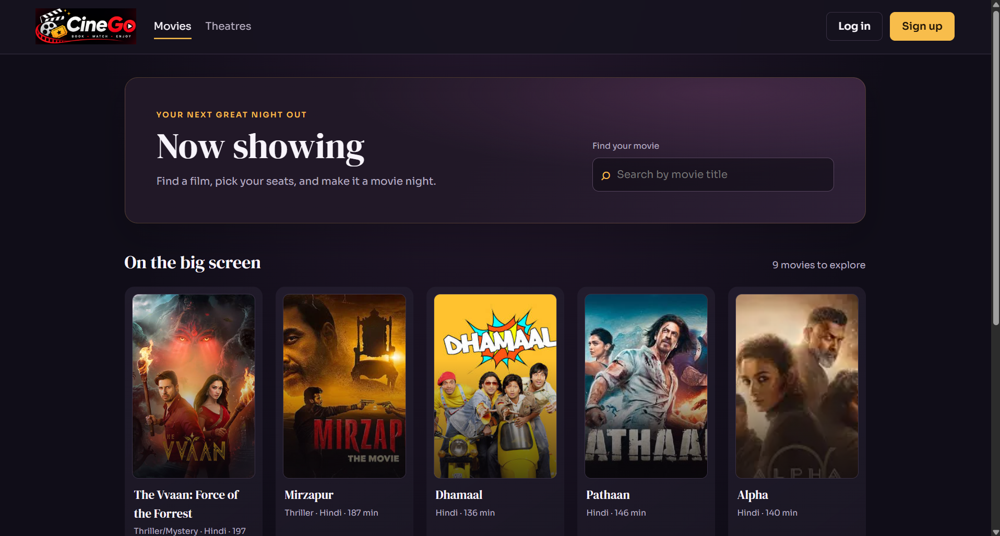

#### Movies Page

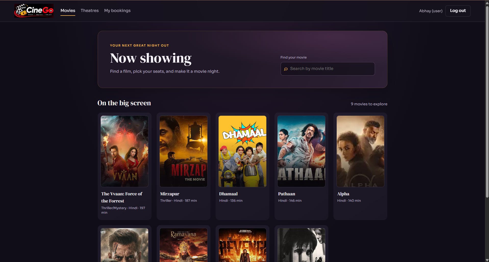

### Booking and payment

#### Available Seats

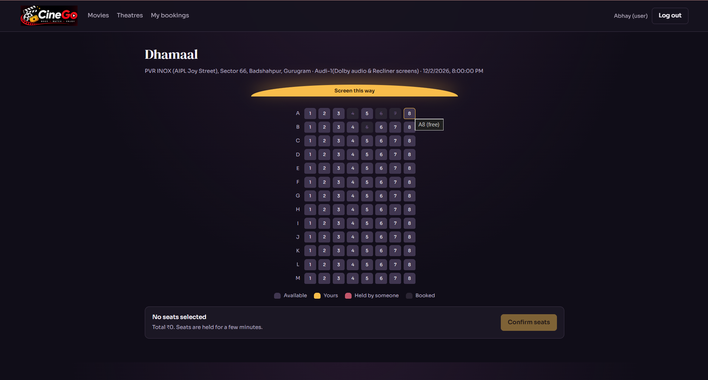

#### Selected Seats

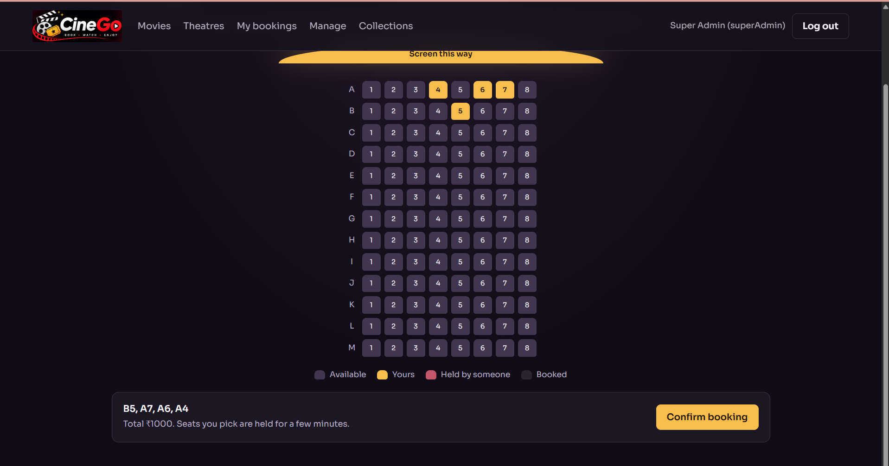

#### Demo Payment Method

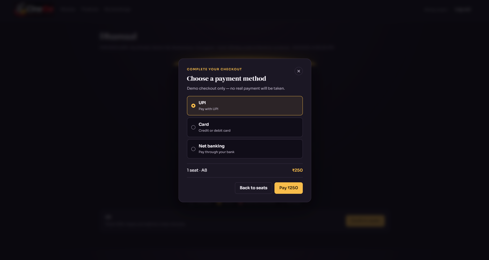

#### Booking Successful

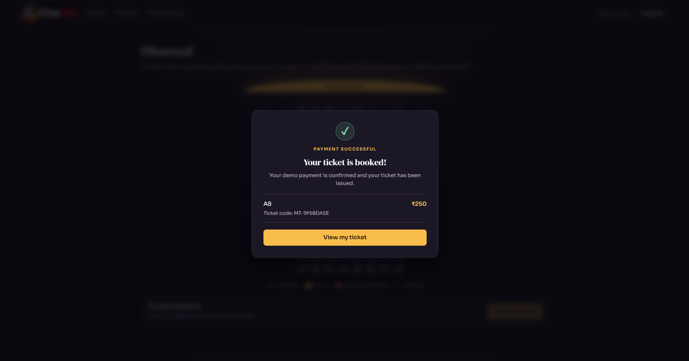

#### My Bookings

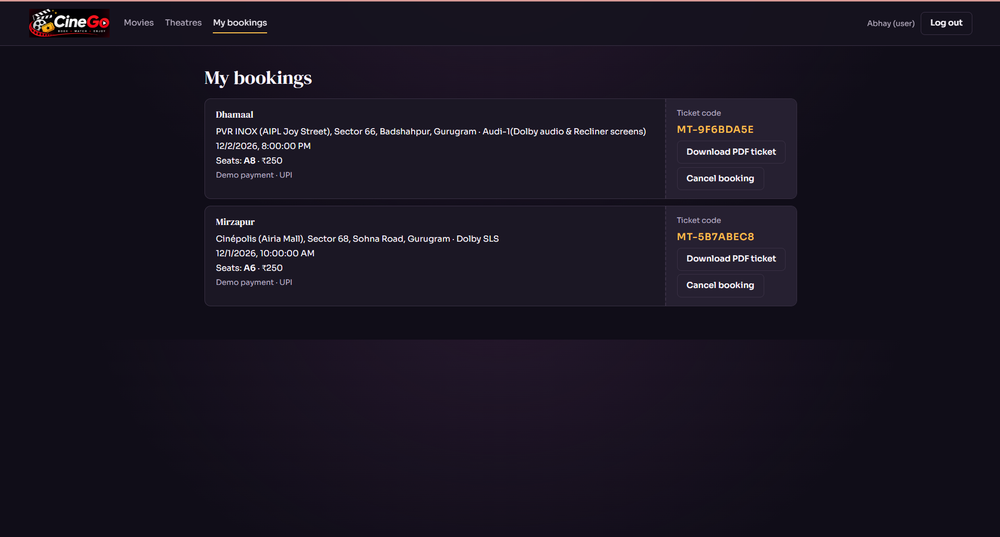

#### PDF Ticket with QR Code

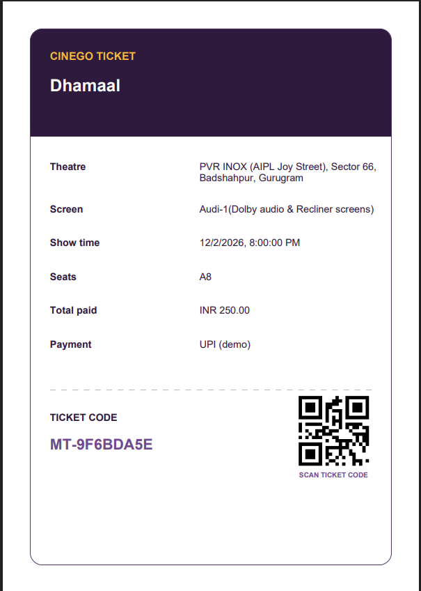

### Super Admin pages

#### Manage Movies

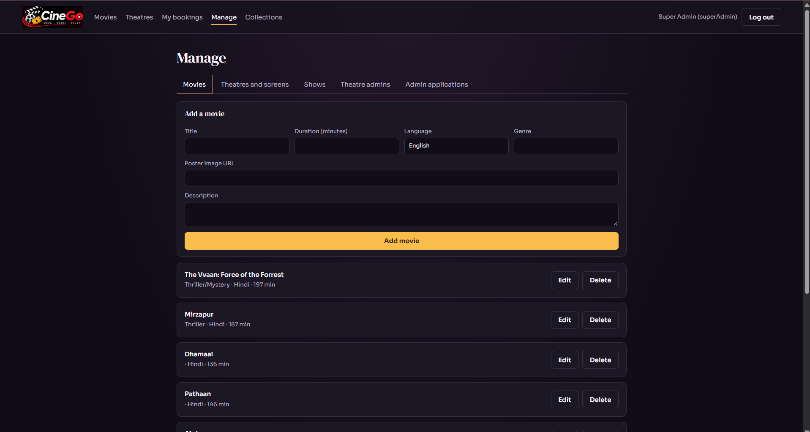

#### Theatre Admin Application Form

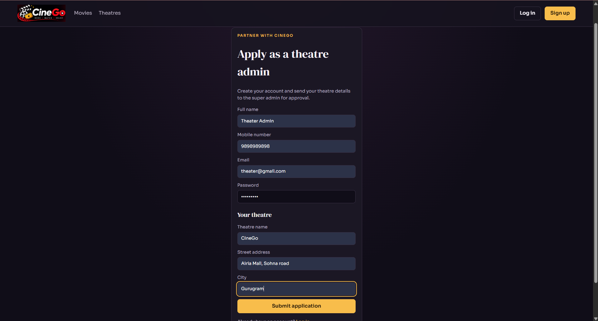

#### Pending Theatre Admin Login

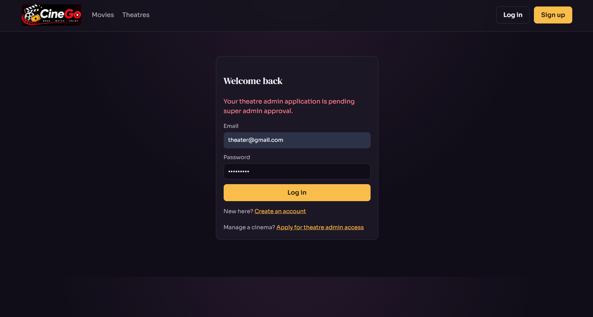

#### Theatre Admin Applications seen on Super Admin page

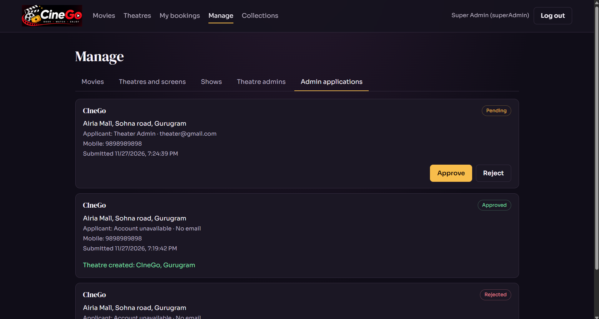

#### Application Approved by Super Admin

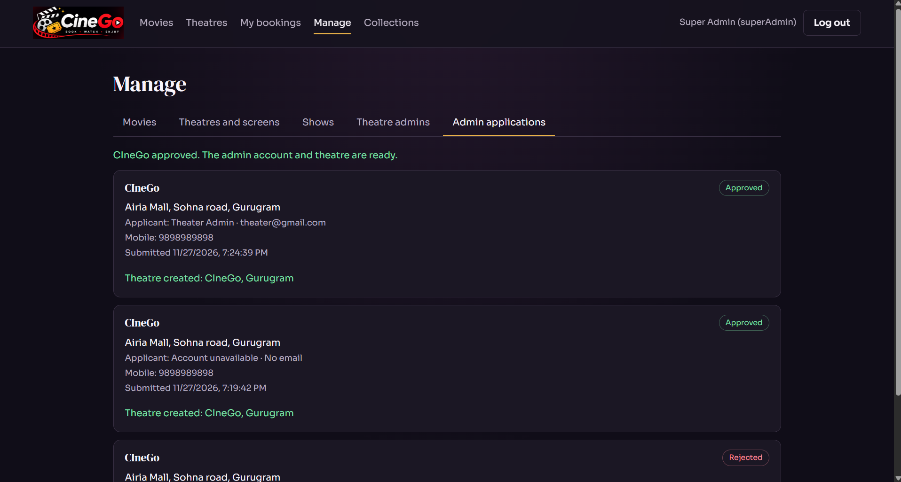

#### Theatre Admin Dashboard

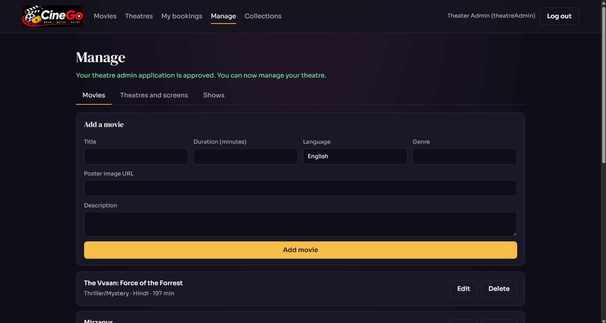


---

**CineGo – BOOK • WATCH • ENJOY**
